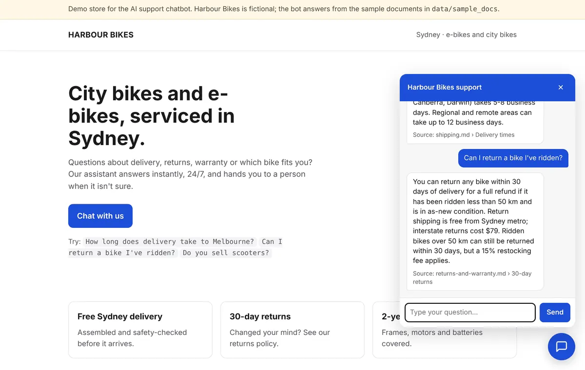
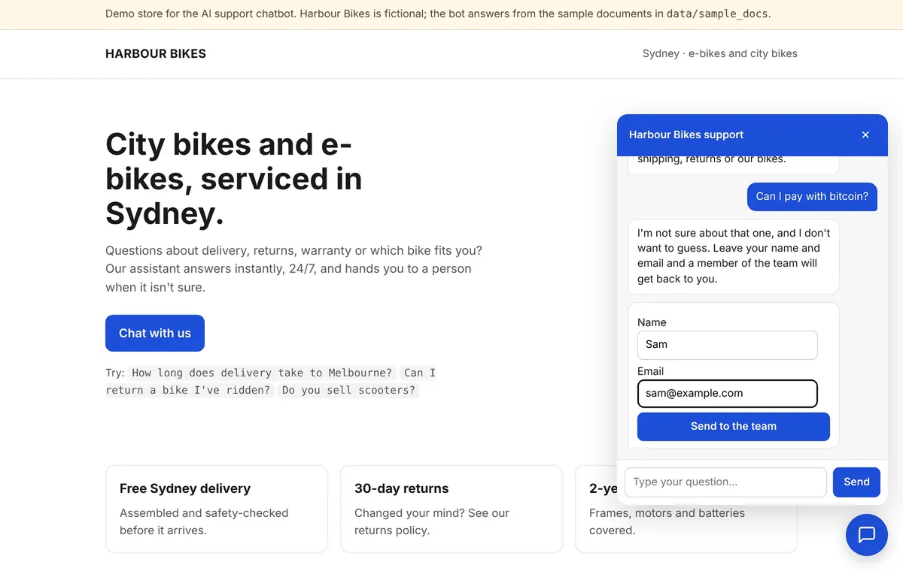
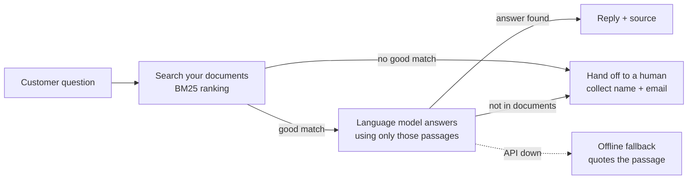

# AI Support Chatbot

A customer-support chatbot that answers questions from **your own documents** (FAQs, shipping and returns policies, product pages) on your **website** and in **Telegram**, and hands the customer to a person when it isn't sure.

- Answers only from your documents, and shows the source it used
- Says "I'm not sure" instead of inventing prices or policies, then collects the customer's name and email for your team
- One-line embed for any website (Shopify, WordPress, Webflow, plain HTML)
- Works with Claude, OpenAI, OpenRouter, Groq or a local Ollama model; switch with one setting
- Runs without any API key in demo mode
- Stores every conversation and lead in a local SQLite database
- Docker-ready, tested, MIT licensed



When the answer isn't in the documents, the bot hands off and captures the lead:



> The demo store, Harbour Bikes, is fictional. Its documents are in `data/sample_docs/`.

## Quick start (2 minutes)

```bash
git clone https://github.com/buildering-dev/ai-support-chatbot.git
cd ai-support-chatbot
pip install -r requirements.txt
uvicorn app.server:app --port 8000
```

Open http://localhost:8000 and click the chat button. With no API key the bot runs in **offline mode**: it answers by quoting the best-matching passage. Add a key (below) for natural, conversational answers.

### With Docker

```bash
cp .env.example .env        # then edit .env
docker compose up -d --build
# Telegram as well:
docker compose --profile telegram up -d --build
```

## Use it for your business

1. **Add your documents.** Put `.md` or `.txt` files in a folder (one topic per heading works best) and set `DOCS_DIR` to it. Restart the bot to re-index.
2. **Choose a model.** In `.env`:

   | Provider | Settings |
   |---|---|
   | Claude | `LLM_PROVIDER=anthropic`, `ANTHROPIC_API_KEY=...`, optional `LLM_MODEL` |
   | OpenAI | `LLM_PROVIDER=openai`, `OPENAI_API_KEY=...`, `LLM_MODEL=gpt-4o-mini` |
   | OpenRouter / Groq / Together | `LLM_PROVIDER=openai`, `OPENAI_BASE_URL=<provider URL>`, key and model |
   | Local Ollama (free, private) | `LLM_PROVIDER=openai`, `OPENAI_BASE_URL=http://localhost:11434/v1`, `LLM_MODEL=llama3.1` |
   | No key (demo) | `LLM_PROVIDER=offline` |

3. **Embed the widget** on your site with one line, pointing at wherever the bot is hosted:

   ```html
   <script src="https://YOUR-BOT-HOST/static/widget.js"
           data-title="Harbour Bikes support"
           data-accent="#1d4ed8"
           data-greeting="Hi! How can I help?" defer></script>
   ```

   Set `ALLOWED_ORIGINS=https://your-site.com` in production.

4. **Telegram (optional).** Create a bot with [@BotFather](https://t.me/BotFather), set `TELEGRAM_BOT_TOKEN`, then run `python -m app.telegram_bot`. Same answers, same lead capture.

5. **Read leads and transcripts** from `data/support.sqlite` (tables `leads` and `messages`). Any SQLite viewer works, or export to CSV:

   ```bash
   sqlite3 -header -csv data/support.sqlite "select * from leads" > leads.csv
   ```

## How it works



- **Search:** documents are split by heading and ranked with BM25, the classic search-engine formula, plus a small synonym list ("how much" → price, "refund" → return). No vector database or embedding API is needed, which keeps it cheap and fast for typical support content.
- **Grounded answers:** the model is told to use only the retrieved passages and to reply `[HANDOFF]` when the answer isn't there. The bot never shows that token; it switches to the lead form instead.
- **Follow-ups:** short follow-ups such as "and on Sunday?" are searched together with the previous question.
- **Resilience:** if the model API errors or times out, the bot falls back to quoting the passage, so customers still get an answer.
- **Safety:** customer messages and documents are treated as data (prompt-injection attempts are ignored by instruction), input length is capped, session ids are validated, CORS is configurable and there is a per-IP rate limit.

## Project layout

```
app/
  config.py        settings from environment / .env
  knowledge.py     document loading, splitting and BM25 search
  llm.py           Claude, OpenAI-compatible and offline model clients (plain HTTP)
  bot.py           retrieval → answer → handoff logic, SQLite logging
  server.py        FastAPI: /api/chat, /api/lead, /health, demo page
  telegram_bot.py  Telegram channel
  static/          widget.js (embeddable) and the demo page
data/sample_docs/  fictional store documents
tests/             21 tests (search quality, handoff, API, providers with mocked HTTP)
```

## Tests

```bash
pip install -r requirements-dev.txt
pytest
```

## Extending

Common additions for client projects: WhatsApp (Meta Cloud API) and Messenger channels, PDF and website ingestion, embeddings for very large knowledge bases, human takeover in a shared inbox, email or Slack alerts for new leads, and CRM sync (HubSpot, GoHighLevel).

## License

MIT
